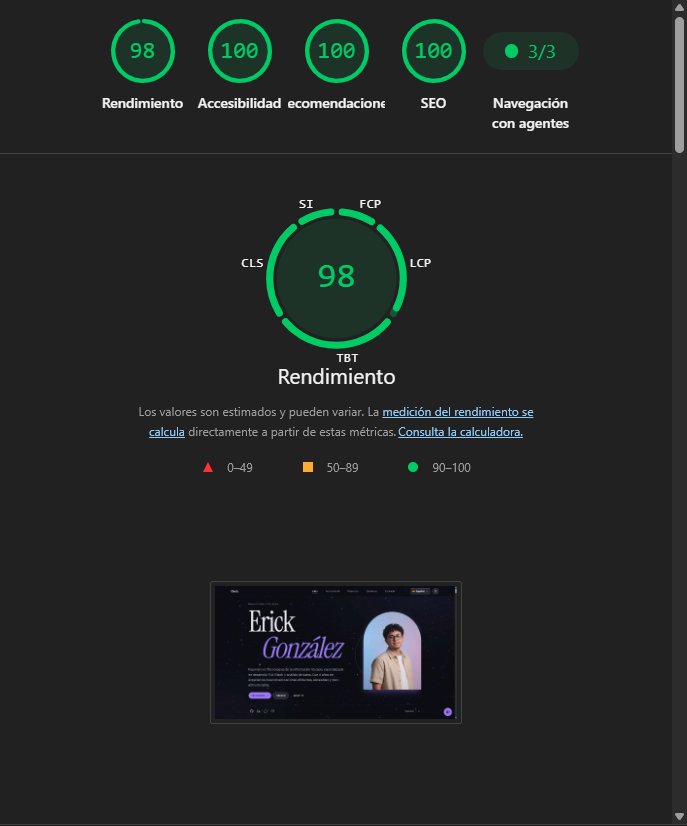

# 🚀 Portafolio Personal

Portafolio construido con [Astro](https://astro.build/) (SSR, `output: "server"`) e islas de [React](https://react.dev/) para las partes interactivas, con [Tailwind CSS v4](https://tailwindcss.com/) (CSS-first, vía `@tailwindcss/vite`) y componentes [shadcn/ui](https://ui.shadcn.com/) sobre [Base UI](https://base-ui.com/). Desplegado en [Cloudflare Workers](https://workers.cloudflare.com/) (con los archivos estáticos como *assets*).

Contenido (proyectos, experiencia, comentarios) servido desde un backend propio externo (Worker de Hono sobre Cloudflare D1 y R2), consumido a través de un proxy interno en `/api/*` que agrega el token de autenticación server-side.

## 🏯 Lighthouse y optimización de la página



## 📋 Tabla de Contenidos

- [🛠️ Tecnologías Utilizadas](#️-tecnologías-utilizadas)
- [📁 Estructura del Proyecto](#-estructura-del-proyecto)
- [⚙️ Requisitos Previos](#️-requisitos-previos)
- [🔧 Instalación](#-instalación)
- [💻 Desarrollo Local](#-desarrollo-local)
- [🧪 Pruebas](#-pruebas)
- [☁️ Infraestructura](#️-infraestructura)
- [🌐 Internacionalización](#-internacionalización)
- [🎨 Temas](#-temas)
- [🧩 Frontend Architecture & Design System](#-frontend-architecture--design-system)
- [📄 Licencia](#-licencia)
- [🤝 Contribuir](#-contribuir)
- [📞 Contacto](#-contacto)

## 🛠️ Tecnologías Utilizadas

- **Framework**: [Astro](https://astro.build/) v7 (SSR con [`@astrojs/cloudflare`](https://docs.astro.build/en/guides/integrations-guide/cloudflare/), desplegado en [Cloudflare Workers](https://workers.cloudflare.com/))
- **UI**: [React](https://react.dev/) v18 (islas vía `@astrojs/react`)
- **Estilos y componentes**: [Tailwind CSS v4](https://tailwindcss.com/) + [shadcn/ui](https://ui.shadcn.com/) sobre [Base UI](https://base-ui.com/)
- **Iconos**: [Lucide](https://lucide.dev/) (`lucide-react`) — única librería de iconos
- **Animación**: [GSAP](https://gsap.com/) con ScrollTrigger, SplitText, MotionPathPlugin y ScrollToPlugin es el estándar para animación de scroll (centralizado en `src/lib/motion/`; ver [Frontend Architecture & Design System](#-frontend-architecture--design-system))
- **3D**: [Three.js](https://threejs.org/) (galaxia de partículas propia con un `ShaderMaterial` y una sola llamada de dibujo, montada como isla `client:idle`)
- **Formularios**: [React Hook Form](https://react-hook-form.com/) + [Zod](https://zod.dev/)
- **Otros**: [TypeScript](https://www.typescriptlang.org/), [react-country-flag](https://www.npmjs.com/package/react-country-flag)
- **Calidad**: [Biome](https://biomejs.dev/) (lint/format) + [Husky](https://typicode.github.io/husky/) (hooks rápidos) + [GitHub Actions](https://docs.github.com/actions) (CI) + [Vitest](https://vitest.dev/) y [Playwright](https://playwright.dev/) (tests), con [axe-core](https://github.com/dequelabs/axe-core) para la auditoría de accesibilidad

## 📁 Estructura del Proyecto

```bash
src/
├── components/           # Componentes compartidos (sections/, ui/ = primitivos shadcn, icons/ = logos de marca, three/ y cosmos/ = fondos)
├── features/             # Lógica por dominio (aboutMe, projects, opinions, contact, navbar)
├── i18n/                 # Traducciones (locales/*.json) y locales.ts (fuente única de verdad de idiomas)
├── layouts/               # Layouts de Astro (Layout)
├── lib/                  # Utilidades server-side (rate limit, cliente del backend) y motion/ (motor GSAP, solo cliente)
├── middleware.ts         # Validación de locale
├── pages/                # Rutas: /[lang]/home, /[lang]/project/[id], /api/*
├── schemas/               # Esquemas de validación Zod
├── styles/               # Estilos globales (Tailwind v4 + tokens del tema)
└── types/                # Tipos TypeScript compartidos
```

## ⚙️ Requisitos Previos

- Node.js >= 22.12.0
- pnpm
- Git

## 🔧 Instalación

- Clona el repositorio:

```bash
    git clone https://github.com/muke78/Portafolio.git
    cd Portafolio
```

- Instala las dependencias:

```bash
    pnpm install
```

- Copia el archivo de variables de entorno y complétalo (ver `astro.config.mjs` → `env.schema` para la lista completa y su documentación):

```bash
    cp .env.example .env
```

## 💻 Desarrollo Local

- Inicia el servidor de desarrollo:

```bash
    pnpm dev
```

- El sitio estará disponible en [http://localhost:4321](http://localhost:4321)

## 🧪 Pruebas

```bash
    pnpm test:unit    # Vitest: tokens de diseño, contraste del texto atenuado, límites del motor de movimiento
    pnpm test:e2e     # Playwright (necesita `pnpm dev` y el backend corriendo)
```

- **E2E**: navegación por scroll y anclas con las secciones fijadas, carga diferida de las islas, formularios, cambio de idioma y detalle de proyecto. Un archivo dedicado verifica `prefers-reduced-motion: reduce` (sin escenas fijadas y con todo el contenido visible).
- **Accesibilidad**: `tests/e2e/a11y.spec.ts` corre axe-core (WCAG 2.1 A/AA) sobre el Home en tema claro y oscuro, a 375 px y en escritorio, además del detalle de proyecto y el diálogo de opiniones. También comprueba un solo `<h1>`, encabezados sin saltos, el enlace para saltar al contenido, el foco visible, el reflujo a 200 % de zoom y el teclado dentro del carril de proyectos.
- Las pruebas de Playwright usan 3 workers y desactivan WebGL (`--disable-3d-apis`) para no saturar el servidor de desarrollo. En local reintentan una vez.
- Biome, `astro check`, Vitest, el build y Playwright corren en GitHub Actions en cada Pull Request (ver [Infraestructura](#️-infraestructura)). En local ya no hay hook de `pre-push`: corre `pnpm check`, `pnpm test:unit` y `pnpm build` antes de abrir el PR.

## ☁️ Infraestructura

Todo el stack corre en **Cloudflare**, sin contenedores (V8 isolates):

| Pieza | Servicio |
|---|---|
| Frontend (este repo, Astro SSR) | **Cloudflare Workers** (adaptador de Astro; Pages ya no lo soporta) |
| API de contenido | **Worker de Hono** ([`Backend_Portafolio`](https://github.com/muke78/Backend_Portafolio)) |
| Base de datos | **Cloudflare D1** |
| Imágenes y archivos | **Cloudflare R2** |

El **panel de administración (CMS) es un sistema *headless* independiente**: ya no vive en este repositorio, así que aquí no hay rutas `/admin/*` ni sesión de administrador. Este sitio consume la API a través del proxy interno `/api/*`, que agrega el token de autenticación del lado del servidor.

**CI/CD** con GitHub Actions (`.github/workflows/`):

- `ci-dev.yml`: cada Pull Request hacia `dev` corre Biome, `astro check`, Vitest y el build.
- `ci-main.yml`: cada Pull Request hacia `main` corre lo mismo más Playwright. El deploy lo hace la integración Git de Cloudflare (Workers Builds: build `npx astro build`, deploy `npx wrangler deploy`, rama de producción `main`); el job de deploy de Actions queda comentado como alternativa.
- Playwright necesita un backend de pruebas: se activa con la variable `E2E_API_URL` y el secreto `E2E_API_SECRET_TOKEN` del repositorio.
- Husky se limita a lo rápido: valida el mensaje del commit y pasa Biome sobre los archivos en staging.

## 🌐 Internacionalización

El proyecto soporta múltiples idiomas, definidos en `src/i18n/locales.ts` (única fuente de verdad, usada tanto por el enrutamiento de Astro como por el selector de idioma):

- 🇪🇸 Español (es) — por defecto
- 🇺🇸 Inglés (en)
- 🇫🇷 Francés (fr)

Las traducciones viven en `src/i18n/locales/{es,en,fr}.json`. El enrutamiento de idioma es `manual` (no automático) — la validación de un segmento de idioma desconocido en `/[lang]/*` ocurre en `src/middleware.ts`.

## 🎨 Temas

Claro/oscuro vía la clase `.dark` en `<html>` (Tailwind v4 `@custom-variant dark`), con persistencia en `localStorage` y detección de `prefers-color-scheme` como valor por defecto.

## 🧩 Frontend Architecture & Design System

El sistema de diseño completo (paleta con contrastes medidos, tipografía, espaciado, componentes base, iconografía y reglas de animación) vive en **[`docs/UI_STANDARDS.md`](./docs/UI_STANDARDS.md)**. Es la fuente de verdad para cualquier cambio de UI, y las reglas obligatorias para agentes de IA están en [`AGENTS.md`](./AGENTS.md).

**Stack de UI**

- **shadcn/ui** (estilo `base-nova`, sobre Base UI): los primitivos viven en `src/components/ui/` y se usan siempre en lugar de HTML estilizado a mano.
- **Tailwind CSS v4**: los tokens de color, radio y fuente están en `src/styles/app.css` (OKLCH, tema claro/oscuro). No se usan colores fuera de esos tokens.
- **Lucide**: única librería de iconos (excepción: logos de marca en `src/components/icons/BrandIcons.tsx`).
- **GSAP + ScrollTrigger + SplitText**: estándar para animación de scroll (escenas fijadas, stagger, máscaras de texto, parallax, trayectorias con MotionPath; solo `transform`/`opacity`, con `prefers-reduced-motion` respetado). El motor vive en `src/lib/motion/` y se arranca una vez desde `Layout.astro`.
- **Paleta**: "Onyx & Violet" — base neutra (oscuro onyx/charcoal, claro silk con texto carbón; nunca `#000`/`#fff`) y un único acento violeta en `--primary`. Los contrastes están medidos y protegidos por `tests/unit/designTokens.test.ts`.
- **Tipografía**: Instrument Serif (titulares), Geist (texto), Geist Mono (etiquetas), autoalojadas con `@fontsource`; tamaños como tokens (`text-display`, `text-title`, `text-subtitle`, `text-heading`).
- **Interacción**: hovers táctiles (`hover-lift`, `hover-press`, `hover-nudge`) y estados de carga con `<Skeleton />`, nunca spinners.
- **Layout del Home**: hero tipográfico a escala de póster (nombre a hasta 200 px, retrato en arco con anillos de órbita) sobre una galaxia de partículas propia que se contrae y estalla con el scroll, y secciones asimétricas 4/8 con mucho espacio negativo. No hay pestañas ni menús: Acerca de, Educación, Experiencia, Habilidades y Proyectos se cuentan en orden mientras se baja. Los proyectos van en carriles horizontales fijados por categoría, la experiencia en una pila de cards y las habilidades flotan por una trayectoria. El contenido de las secciones bajas se pide al cargar cuando se acercan al viewport. El movimiento lo gobierna un motor GSAP (`src/lib/motion/`) que se comunica con el HTML solo por atributos de datos; todo respeta `prefers-reduced-motion`. Detalle en las secciones 7.7 y 12 de `docs/UI_STANDARDS.md`.
- **Detalle de proyecto**: cada card del Home abre `/[lang]/project/[slug]`, una vista propia y compartible (SSR, con su `<title>` y `og:image`).

**Accesibilidad**: el objetivo es WCAG 2.1 AA, auditado automáticamente con axe-core en ambos temas y en móvil y escritorio (ver [Pruebas](#-pruebas)). El texto que se enciende con el scroll nunca baja de un piso de contraste medido por tema. El checklist y las deudas conocidas (por ejemplo, el contraste del borde de los campos) están en `docs/UI_STANDARDS.md`.

## 📄 Licencia

Este proyecto está bajo la licencia MIT. Ver el archivo LICENSE para más detalles.

## 🤝 Contribuir

Las contribuciones son bienvenidas. Por favor, abre un issue o pull request para sugerir cambios o mejoras.

## 📞 Contacto

Si tienes alguna pregunta o sugerencia, no dudes en contactarme:

- Nombre: [Erick Gonzalez](https://github.com/muke78)
- Correo : <erickm.gonzalez.rivera@gmail.com>

⭐️ Si te gusta este proyecto, ¡no olvides darle una estrella en GitHub!
